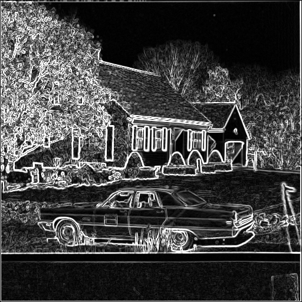

# Filtro de Sobel 3x3: implementação em CUDA e comparação de desempenho

**UFGRS - INF01008 - Programação Paralela - 2026/2**

Este projeto implementa o algoritmo detecção de bordas de Sobel em C e CUDA e compara seus respectivos desempenhos.

## O que é o Filtro de Sobel

O **Sobel** é um algoritmo de processamento de imagens que realça **bordas**: regiões nas quais a intensidade dos pixels muda de forma abrupta. Em uma foto em tons de cinza, por exemplo, essas mudanças normalmente correspondem aos contornos de objetos, letras, linhas e limites entre áreas claras e escuras. A imagem de saída não é uma cópia colorida ou suavizada da entrada; ela representa a **força das bordas** encontradas em cada posição.

Para calcular cada pixel de saída, o algoritmo observa uma janela 3x3 centrada no pixel correspondente da imagem de entrada. Nessa janela, ele aplica duas máscaras (convoluções):

```text
Gx = [-1  0  1]       Gy = [-1 -2 -1]
     [-2  0  2]            [ 0  0  0]
     [-1  0  1]            [ 1  2  1]
```

- `Gx` mede a variação da intensidade da esquerda para a direita e, portanto, destaca principalmente bordas verticais.
- `Gy` mede a variação de cima para baixo e destaca principalmente bordas horizontais.

Em seguida, o programa combina os dois gradientes com a magnitude

```text
magnitude = sqrt(Gx² + Gy²)
```

Quanto maior essa magnitude, mais forte é a transição local e mais claro será o pixel na imagem de saída. O resultado é limitado a 255, pois o PGM usado pelo projeto possui pixels de 8 bits (`0` = preto, `255` = branco), e depois é arredondado para o inteiro mais próximo. Os pixels da borda externa recebem zero (preto), pois não possuem todos os oito vizinhos necessários para formar uma janela 3x3.

| Imagem original | Imagem com filtro aplicado |
|---|---|
|  |  |

## Como a implementação executa o Sobel

As duas versões produzem a mesma imagem e aplicam exatamente as máscaras acima:

- Na versão sequencial, dois laços percorrem a imagem e calculam um pixel de saída por vez na CPU.
- Na versão CUDA, cada thread calcula um pixel de saída. A imagem é achatada em um vetor: o índice global da thread identifica o pixel, que é convertido de volta nas coordenadas `x` e `y`. A grade tem blocos de 256 threads; threads cujo índice ultrapassa o total de pixels encerram sem acessar memória inválida.

A implementação CUDA usa memória unificada (`cudaMallocManaged`), cada thread lê diretamente a sua vizinhança 3x3 e a CPU sincroniza antes de usar o resultado. Ela prioriza a clareza e a equivalência com a versão sequencial, deixando o uso de memória compartilhada como uma otimização posterior.

## Organização de arquivos e pastas

```text
.
├── images/
│   ├── png-input/       # imagens PNG originais
│   ├── png-output/      # resultados PNG visualizáveis
│   ├── pgm-input/       # entradas PGM para os executáveis
│   └── pgm-output/      # resultados PGM dos testes e benchmarks
├── notebooks/
│   └── sobel_cuda_colab.ipynb  # execução opcional no Google Colab
├── scripts/
│   ├── processar_imagem.py     # PNG/JPG/TIFF -> Sobel -> PNG/JPG
│   ├── gerar_imagem.py         # cria imagens PGM sintéticas
│   └── comparar.py              # compara duas imagens PGM
├── src/
│   ├── sobel_seq.c             # implementação sequencial em C
│   ├── sobel_cuda.cu           # implementação paralela em CUDA
│   ├── pgm.h                   # leitura e escrita de PGM P5
│   └── sobel_seq / sobel_cuda  # executáveis gerados pela compilação
├── cuda_content_learned/       # exemplos e material CUDA da disciplina
├── graphics-material/          # material complementar da disciplina
├── Makefile
└── README.md
```

## Requisitos

- Um compilador C compatível com C11 (`gcc`) e GNU Make para a versão CPU.
- NVIDIA CUDA Toolkit (`nvcc`) e GPU NVIDIA compatível com CUDA para a versão GPU.
- Python 3 e Pillow somente para os testes que usam PNG/JPG/JPEG/TIFF.

## Windows: instalação e configuração

No Windows, o driver NVIDIA, o CUDA Toolkit, o compilador C/C++ e o GNU Make são componentes diferentes. Instale e valide todos antes de compilar a versão GPU.

### CPU: MSYS2, GCC e GNU Make

Instale o [MSYS2](https://www.msys2.org/) e abra o terminal **MSYS2 UCRT64**. Atualize-o com:

```bash
pacman -Syu
```

Se o terminal solicitar, feche-o e abra novamente o **MSYS2 UCRT64**. Depois instale o compilador e as ferramentas de desenvolvimento:

```bash
pacman -S --needed base-devel mingw-w64-ucrt-x86_64-gcc
```

Nesse terminal, `gcc` e `make` estarão disponíveis e a versão CPU pode ser compilada com `make cpu`.

### GPU: CUDA Toolkit e compilador Microsoft

1. Confirme que a GPU NVIDIA e o driver estão ativos:

   ```bat
   nvidia-smi
   ```

   A linha `CUDA Version` do `nvidia-smi` representa a compatibilidade máxima do **driver**; ela não confirma que o compilador `nvcc` está instalado.

2. Instale o [NVIDIA CUDA Toolkit para Windows x86_64](https://developer.nvidia.com/cuda-downloads). Após a instalação, abra um novo terminal e confirme:

   ```bat
   nvcc --version
   ```

3. Instale o [Build Tools for Visual Studio 2022](https://aka.ms/vs/17/release/vs_BuildTools.exe). No instalador, selecione a carga **Desktop development with C++** e confirme estes componentes:

   - **MSVC v143 – VS 2022 C++ x64/x86 build tools**;
   - **Windows 10 SDK** ou **Windows 11 SDK**.

   O `nvcc` usa o compilador Microsoft (`cl.exe`) como compilador auxiliar no Windows.

### Compilar CUDA no Windows

Abra **x64 Native Tools Command Prompt for VS 2022** pelo Menu Iniciar. Nesse terminal, entre na raiz do projeto e inclua o CUDA Toolkit e o GNU Make do MSYS2 no `PATH`:

```bat
cd C:\caminho\para\ufrgs-sobel-cuda-parallel
set "PATH=%CUDA_PATH%\bin;C:\msys64\usr\bin;%PATH%"

where make
where nvcc
where cl
```

Os três comandos devem mostrar um caminho. Então compile e execute:

```bat
make gpu
src\sobel_cuda.exe images\pgm-input\pic1.pgm images\pgm-output\pic1_gpu.pgm 10
```

Para compilar sem o Make, use o comando equivalente:

```bat
nvcc -O3 src\sobel_cuda.cu -o src\sobel_cuda.exe
```

No PowerShell, use `where.exe make` em vez de `where make`, pois `where` é um alias do PowerShell. Se o projeto incluir o perfil **CUDA (VS Build Tools)** em `.vscode/settings.json`, depois de instalar ou alterar as ferramentas execute **Developer: Reload Window**, feche os terminais existentes e escolha **Terminal: Create New Terminal (With Profile)**. Selecione esse perfil: ele deve abrir como `cmd`, mostrar o banner do Visual Studio e permitir `make gpu`.

## Teste rápido

Execute na raiz do projeto. Este teste usa `images/pgm-input/pic1.pgm`, portanto **não requer Python nem Pillow**. O tempo médio aparece no terminal; as saídas ficam em `images/pgm-output/`.

```bash
# 1. Compilar e executar a versão CPU
make cpu
./src/sobel_seq images/pgm-input/pic1.pgm images/pgm-output/pic1_cpu.pgm 10

# 2. Compilar e executar a versão GPU
make gpu
./src/sobel_cuda images/pgm-input/pic1.pgm images/pgm-output/pic1_gpu.pgm 10
```

No Windows, use `src\sobel_seq.exe` e `src\sobel_cuda.exe` para executar os binários. Consulte a seção [Windows: instalação e configuração](#windows-instalação-e-configuração) para preparar o terminal. No macOS, somente o teste CPU é suportado: CUDA exige uma GPU NVIDIA compatível, indisponível nos Macs atuais.

## Teste rápido com PNG (opcional)

Use esta alternativa para gerar uma saída PNG que pode ser aberta diretamente. Ela requer Pillow; instale-o dentro de uma venv para não alterar o Python global.

No Linux/macOS:

```bash
python3 -m venv .venv
source .venv/bin/activate
python -m pip install --upgrade pip Pillow

make cpu
python scripts/processar_imagem.py images/png-input/pic1.png --modo cpu --saida pic1_cpu.png --sobrescrever

make gpu
python scripts/processar_imagem.py images/png-input/pic1.png --modo gpu --saida pic1_gpu.png --sobrescrever
```

No Windows, em um terminal `cmd` já configurado conforme a seção anterior:

```bat
py -m venv .venv
.venv\Scripts\activate.bat
python -m pip install --upgrade pip Pillow

make cpu
python scripts/processar_imagem.py images/png-input/pic1.png --modo cpu --saida pic1_cpu.png --sobrescrever

make gpu
python scripts/processar_imagem.py images/png-input/pic1.png --modo gpu --saida pic1_gpu.png --sobrescrever
```

As saídas são gravadas em `images/png-output/`.

## Outros comandos de terminal

### Instalar Pillow

```bash
# Linux/macOS
python3 -m pip install Pillow

# Windows
py -m pip install Pillow
```

### Compilar as duas versões

```bash
make
```

### Solução de problemas no Windows

| Mensagem ou sintoma | Causa provável e solução |
|---|---|
| `make` não é reconhecido | Instale o MSYS2 e adicione `C:\msys64\usr\bin` ao `PATH` do terminal atual. Em PowerShell, confirme com `where.exe make`. |
| `nvcc: No such file or directory` ou `nvcc` não é reconhecido | Instale o CUDA Toolkit; o driver NVIDIA sozinho não inclui o `nvcc`. Abra um novo terminal e confira `nvcc --version`. |
| `Cannot find compiler 'cl.exe'` | Instale **Desktop development with C++** e o **MSVC v143 x64/x86**. Compile no **x64 Native Tools Command Prompt for VS 2022**. |
| `make: Nothing to be done for 'cpu'` ou `gpu` | Não é erro: o executável já está atualizado. Para recompilar à força, use `make -B cpu` ou `make -B gpu`. |
| `WinError 4551` / política de Controle de Aplicativo | O Windows bloqueou um executável local por política de segurança. Verifique `Applications and Services Logs > Microsoft > Windows > CodeIntegrity > Operational` no Visualizador de Eventos e solicite ao administrador/à TI uma regra que permita o executável. Não desative políticas de segurança para contornar o bloqueio. |

### Processar outra imagem

Troque `minha_foto.png` pelo arquivo desejado. O argumento opcional `--repeticoes` define quantas execuções entram na média (padrão: 10).

```bash
python3 scripts/processar_imagem.py images/png-input/minha_foto.png --modo cpu --repeticoes 30
python3 scripts/processar_imagem.py images/png-input/minha_foto.png --modo gpu --repeticoes 30
```

Para escolher o nome da saída ou substituir uma existente:

```bash
python3 scripts/processar_imagem.py images/png-input/minha_foto.png --modo cpu \
  --saida bordas.png --sobrescrever
```

### Benchmark com imagens PGM

No Windows, use `py` no lugar de `python3` e `src\sobel_seq.exe` / `src\sobel_cuda.exe` no lugar dos executáveis mostrados abaixo.

```bash
python3 scripts/gerar_imagem.py 1024 1024 images/pgm-input/imagem_1024.pgm
python3 scripts/gerar_imagem.py 2048 2048 images/pgm-input/imagem_2048.pgm
python3 scripts/gerar_imagem.py 4096 4096 images/pgm-input/imagem_4096.pgm
./src/sobel_seq images/pgm-input/imagem_4096.pgm images/pgm-output/cpu_4096.pgm 30
./src/sobel_cuda images/pgm-input/imagem_4096.pgm images/pgm-output/gpu_4096.pgm 30
python3 scripts/comparar.py images/pgm-output/cpu_4096.pgm images/pgm-output/gpu_4096.pgm
```

A versão sequencial mostra **tempo de processamento** (sem E/S). A versão CUDA mede, no host, cada lançamento do kernel seguido de sua sincronização e divide o total pelo número de repetições; a alocação, a leitura e a escrita de arquivo ficam fora da medição. Ambas as versões fazem aquecimento antes das medições. Como a versão CUDA usa memória unificada, não há cópias H2D/D2H explícitas no código. Execute no mesmo computador e com a mesma imagem e número de repetições.

## License

Distributed under the MIT License. See `LICENSE.txt` for more information.