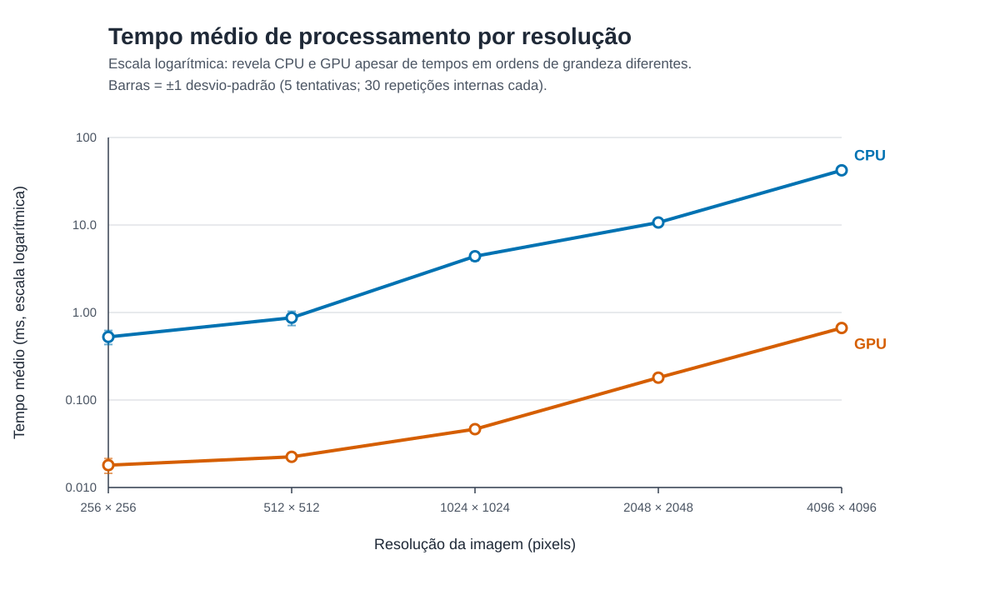
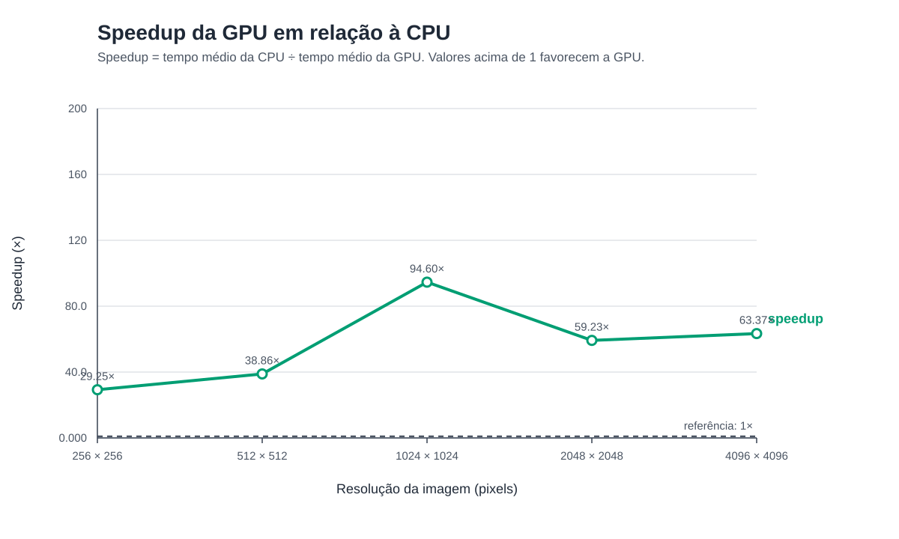

# Resultados do experimento: Sobel sequencial versus CUDA

Este relatório foi gerado automaticamente por `scripts/executar_experimento.py`; os valores não são estimativas nem resultados reutilizáveis de outra máquina.

## Configuração da máquina

| Item | Valor |
|---|---|
| Sistema operacional | Windows-11-10.0.26200-SP0 |
| CPU | Intel64 Family 6 Model 186 Stepping 2, GenuineIntel |
| Memória RAM | 15.7 GiB |
| GPU / driver | NVIDIA GeForce RTX 4050 Laptop GPU, 6141 MiB, 617.14 |
| CUDA Toolkit (`nvcc --version`) | nvcc: NVIDIA (R) Cuda compiler driver Copyright (c) 2005-2026 NVIDIA Corporation Built on Sun_Oct_12_19:25:36_Pacific_Standard_Time_2026 Cuda compilation tools, release 13.5, V13.5.37 Build cuda_13.5.r13.5/compiler.39125733_0 |
| Compilador C | gcc (Rev7, Built by MSYS2 project) 16.2.0 |
| Python que executou o experimento | 3.14.8 (tags/v3.14.8:8e6e75d, Sep 30 2026, 18:19:33) [MSC v.1944 64 bit (AMD64)] |
| Gerado em (UTC) | 2026-11-15T03:58:31+00:00 |

## Método

Foram solicitadas **5 tentativas independentes** por implementação e resolução. Cada execução informou a média de **30 repetições internas**, após o aquecimento já implementado nos executáveis.

A medida da CPU é somente o Sobel. A medida da GPU é o tempo no host de lançamento do kernel mais `cudaDeviceSynchronize()` por repetição; leitura, escrita e alocações ficam fora da região cronometrada. O speedup é `tempo médio CPU / tempo médio GPU`.

## Resultados

| Resolução | Tempo médio CPU (ms) | Tempo médio GPU (ms) | Speedup | Saídas idênticas? |
|---:|---:|---:|---:|:---:|
| 256 × 256 | 0.526527 ± 0.095627 | 0.017999 ± 0.003468 | 29.253× | Sim |
| 512 × 512 | 0.870753 ± 0.161113 | 0.022409 ± 0.002250 | 38.857× | Sim |
| 1024 × 1024 | 4.392723 ± 0.493147 | 0.046437 ± 0.001054 | 94.596× | Sim |
| 2048 × 2048 | 10.670991 ± 0.214976 | 0.180161 ± 0.018817 | 59.230× | Sim |
| 4096 × 4096 | 42.127892 ± 0.553141 | 0.664781 ± 0.031800 | 63.371× | Sim |

## Gráficos

Os gráficos usam cores distinguíveis e rótulos diretos nas séries. O gráfico de tempo usa escala logarítmica no eixo vertical, necessária para tornar visíveis simultaneamente os tempos de CPU e GPU, que estão em ordens de grandeza diferentes; as barras indicam ±1 desvio-padrão entre as tentativas. O gráfico de speedup mantém a linha tracejada de 1× como ponto de equilíbrio.

## Interpretação automática

O primeiro tamanho avaliado em que a GPU foi mais rápida foi **256 × 256** (speedup de **29.253×**).

As medições brutas estão em `medicoes_brutas.csv`; a saída completa de cada execução e a comparação das imagens estão em `logs/`. O desvio apresentado na tabela é o desvio-padrão entre as tentativas, não entre as repetições internas.
